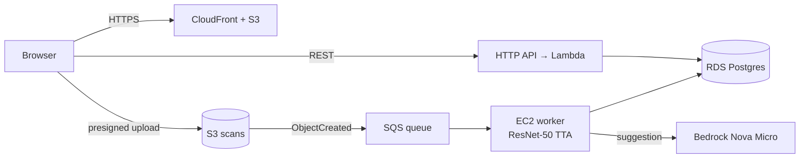

# SightX: Diabetic Retinopathy Detection System

## 🔬 The SightX Story
Diabetes is a global challenge, and Diabetic Retinopathy remains a leading cause of preventable blindness. For many, the first symptom is permanent vision loss. **SightX was built with a personal mission:** to bridge the gap between advanced medical AI and the patients who need it most, honoring a family journey with diabetes.

By combining a **ResNet-50 V2** backbone with Bayesian decision theory and a "No-Line" clinical UI, SightX provides a robust, safe, and beautiful screening experience. 

Please see through the links for more info and backstory on SightX.
### The Developmental Journey of SightX(Blog): [Click Here](https://darkmatterstech.blogspot.com/)
### Live Demonstration of SightX: [Click Here](https://www.linkedin.com/posts/bibesh-timalsina-a7a9482b9_machinelearning-healthcareai-medicalimaging-ugcPost-7446367081786429441-7i4O/?utm_source=share&utm_medium=member_desktop&rcm=ACoAAEx9-_4BQ4M633FOjbaeDu75W0pIsa5375U)
---

## ☁️ V2: SightX on AWS

V1 was about security: Supabase authentication, row-level security and institutional RHEL servers. **V2 is about cloud usability**: an open trial on AWS that anyone can try without signing in, built to stay up on its own and cost about $32 a month.



1. Enter made-up patient details and upload a fundus image. It goes straight from the browser to S3.
2. S3 queues the scan; a self-healing EC2 worker grades it with the 108-pass TTA ensemble.
3. Bedrock (Amazon Nova Micro) adds a short suggestion from the patient's earlier results, never their name or ID.
4. You record the final diagnosis, once.

**📖 [System Design & Architecture ➔](./SYSTEM_DESIGN.md)**: full diagrams, scan lifecycle, data model, trust model, failure handling and costs.
**🧭 [Decision Records ➔](./Docs/decisions/)**: why each piece was chosen and what was rejected.

| Component | Responsibility | Tech Stack | Documentation |
| :--- | :--- | :--- | :--- |
| **Frontend** | Trial UI: upload, live status, decision, history | React, MUI, Vite | [View README](./frontend/README.md) |
| **API** | Jobs, presigned uploads, decisions | Node.js 22 on Lambda, API Gateway | [View README](./api/README.md) |
| **Inference Engine & Worker** | ResNet AI, clinical post-processing, Bedrock suggestion | PyTorch, SQS worker on EC2, FastAPI (local) | [View README](./inference-engine/README.md) |
| **Database** | Patients and jobs, write-once decisions | PostgreSQL 16 on RDS | [View README](./db/README.md) |
| **Infrastructure** | Every AWS resource, deploy runbook | Terraform | [View README](./infrastructure/README.md) |

---

## 🌟 Technical Highlights
### 1. Clinical-Grade AI Safety
- **108-Iteration TTA Ensemble**: Robustness against camera artifacts using Test-Time Augmentation, batched for CPU inference.
- **Bayesian Prior Correction**: Adjusts for training-set bias (EyePACS) to reflect real-world clinical prevalence.
- **Risk-Minimized Decisions**: Uses an asymmetric cost matrix to prioritize patient safety over raw accuracy.

### 2. Cloud Reliability on a Student Budget
- **Queue-based processing**: Scans wait safely in SQS; failed scans retry, then land in a dead-letter queue with an alarm.
- **Self-healing worker**: An Auto Scaling group of one replaces a failed instance; systemd restarts a crashed process.
- **No NAT gateway, no idle endpoints**: Private resources never need the internet, which keeps networking at $0.
- **Least privilege throughout**: Separate IAM and database roles per service, IAM database auth, SSM instead of SSH.

### 3. Clinical UI
- **The "No-Line" Rule**: A design philosophy utilizing tonal layering and depth instead of harsh borders.
- **Clinical Aesthetics**: Glassmorphism and high-performance animations tailored for medical environments.

---

## 📋 Prerequisites

| Tool | Version | For |
| :--- | :--- | :--- |
| **Node.js** | 22 | Frontend and API |
| **Python** | 3.10+ | Inference engine and worker |
| **Terraform** | 1.10+ | Deploying to AWS |
| **AWS CLI v2** + Session Manager plugin | latest | Deploying and operating |

---

## 🚀 Quick Start

### Run pieces locally
```bash
# API tests
cd api && npm ci && npm test

# Inference engine: local FastAPI server for the model
cd inference-engine && pip install -r requirements.txt && uvicorn main:app --reload

# Frontend against a deployed API
cd frontend && npm ci
echo "VITE_API_URL=https://<your-api-id>.execute-api.us-east-2.amazonaws.com" > .env.local
npm run dev
```

### Deploy to AWS
Build the API package, `terraform apply`, run the migrations over SSM, and sync the frontend to S3. Every step, plus updates, logs, pausing and teardown, is in the **[Infrastructure README](./infrastructure/README.md)**.

---

## 🩺 Clinical Operating Mandate

### 1. Optical Hardware Requirements
SightX is optimized for high-resolution retinal imaging. To ensure diagnostic accuracy, images **must** be captured using professional **Digital Fundus Cameras**:
- **Field of View (FOV)**: Minimum 45° horizontal (non-mydriatic preferred).
- **Resolution**: Minimum 30 pixels per degree (ppd).
- **Standards**: Images should ideally be DICOM-compliant with unique patient identifiers at the point of capture.
- **Environment**: Controlled lighting to minimize artifacts and lens flare.

### 2. The V2 Trial and Real Patient Data
- **The V2 trial is open and has no sign-in.** Use **made-up patient details only**. Each browser gets its own anonymous session, which keeps visitors apart but is not authentication.
- Uploaded images are deleted after 7 days.
- **A clinical deployment** would need authentication and role-based access (as in V1), a worker in a private subnet, institutional review, and HIPAA/GDPR coverage including a Business Associate Agreement for every service that touches patient data (RDS, S3, Bedrock).

---

> [!IMPORTANT]
> **Clinical Disclaimer**: SightX is currently a research and educational project. It is intended to demonstrate the potential of AI in telemedicine and should not be used as a primary diagnostic tool without clinical validation and institutional approval.

---
**Built with care to serve people**
