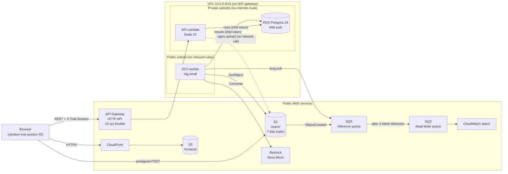
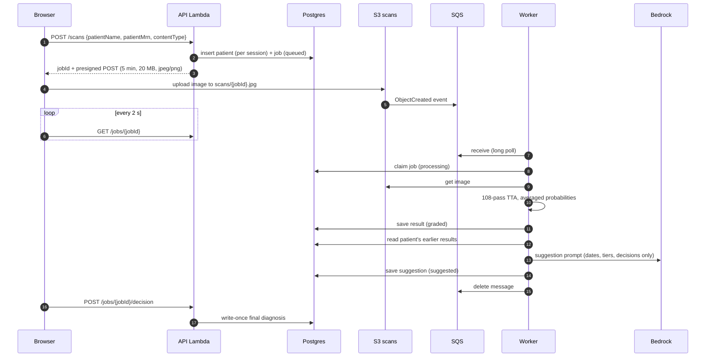

# SightX: System Design & Architecture (V2)

SightX V2 is an **open cloud trial** of the SightX diabetic retinopathy screener on AWS. Anyone can open the site, upload a fundus image and get a graded result with an AI suggestion, without signing in. V1 focused on institutional security (Supabase auth, row-level security, RHEL deployment); V2 focuses on running the same model reliably and cheaply in the cloud.

Everything in this document is defined in code: the application in `frontend/`, `api/`, `inference-engine/` and `db/`, and the AWS resources in `infrastructure/` (Terraform). Why each piece was chosen is recorded in [`Docs/decisions/`](./Docs/decisions/).

---

## 1. Architecture

| Component | Code | Runs on | Responsibility |
| :--- | :--- | :--- | :--- |
| **Frontend** | `frontend/` | S3 + CloudFront | React app: patient details, upload, live job status, final decision, history |
| **API** | `api/` | Lambda (private subnets) behind an HTTP API | Creates jobs, signs uploads, returns job status, records the decision |
| **Inference worker** | `inference-engine/worker.py` | EC2 Auto Scaling group of one (public subnet) | Grades scans with the ResNet-50 TTA ensemble, asks Bedrock for a suggestion |
| **Predictor** | `inference-engine/predictor.py` | Inside the worker (and the local FastAPI server) | Model loading, TTA, Bayesian prior correction, risk-minimized tier |
| **Database** | `db/migrations/` | RDS PostgreSQL 16 (private subnets) | Patients and jobs, scoped to trial sessions |
| **Infrastructure** | `infrastructure/` | Terraform, state in S3 | Every AWS resource above |

Two rules shape the network: **nothing in the private subnets needs the internet**, and **nothing can open a connection to the worker**. The API Lambda only talks to RDS and signs S3 uploads locally; the worker reaches SQS, S3, Bedrock and GitHub through its public IP and has no inbound rules. This avoids a NAT gateway (~$33/month) and paid interface endpoints. See [decision 01](./Docs/decisions/01-vpc-networking.md).

---

## 2. Lifecycle of one scan

1. **Patient details first.** The scan page asks for the patient's name and ID before upload, so the job joins that patient's history.
2. **The job row exists before the image.** `POST /scans` writes the row, then returns a presigned POST locked to the job's key, content type and a 20 MB limit. The image never passes through Lambda.
3. **S3 queues the work.** The upload itself triggers the SQS message; the API needs no queue access.
4. **The worker grades it.** It claims the job, runs the TTA ensemble (`TTA_PASSES`, batched), stores the averaged result and commits before deleting the message.
5. **Bedrock adds a suggestion.** The worker reads up to 10 earlier results for the same patient with a fixed, parameterized query and sends only dates, AI tiers and clinician decisions to Amazon Nova Micro. Names, patient IDs and SQL never reach the model. A failed suggestion leaves the job `graded`.
6. **The browser polls** `GET /jobs/{id}` every 2 seconds (up to 5 minutes for the grade, 45 seconds more for the suggestion).
7. **The clinician decides.** `POST /jobs/{id}/decision` records one of the three tiers, once. A database trigger rejects any later change.

Job status moves `queued → processing → graded → suggested`, or to `failed`.

---

## 3. Data model

Defined in [`db/migrations/`](./db/migrations/), documented in [`db/README.md`](./db/README.md).

| Table | Key columns | Notes |
| :--- | :--- | :--- |
| `patients` | `session_id`, `mrn`, `full_name` | `mrn` is unique **per session**, so one visitor's history never reaches another visitor's suggestion |
| `jobs` | `session_id`, `patient_id`, `image_key`, `status`, `attempts`, `error`, `result` (jsonb), `ai_diagnosis` (generated), `suggestion`, `final_diagnosis` | The decision is write-once (trigger) and needs a graded result (check constraint) |

Two password-less database roles log in with IAM auth tokens: `sightx_api` can only write the decision columns; `sightx_worker` can only write status, result and suggestion columns.

---

## 4. Trust model: an open trial

V2 has **no sign-in** by design ([decision 02](./Docs/decisions/02-trial-without-sign-in.md)). What protects it instead:

| Concern | Control |
| :--- | :--- |
| Visitors seeing each other's scans | Every row belongs to a random browser session ID; every query is scoped to it. This separates data; it is not authentication. |
| Real patient data | The UI and docs require made-up patient details; images expire after 7 days. |
| Abuse and cost | API Gateway throttling (10 rps, burst 20) for all callers; a single worker bounds inference cost; Bedrock costs ~$0.0001 per scan. |
| Uploads | Presigned POSTs pin key, type and size, expire in 5 minutes, and carry a role that may only write `scans/*`. |
| Least privilege | Separate IAM roles and database roles for the API and the worker; IAM database auth (no stored app passwords); IMDSv2 only; SSM instead of SSH. |
| Transport | TLS everywhere: buckets deny non-TLS requests, CloudFront redirects to HTTPS, Postgres connections require TLS. |

A real clinical deployment would bring back authentication (as in V1), move the worker into a private subnet behind a NAT gateway or interface endpoints, and need a HIPAA Business Associate Agreement covering Bedrock.

---

## 5. Reliability

| Failure | What happens |
| :--- | :--- |
| Worker instance dies | The Auto Scaling group replaces it; messages wait in SQS (kept 4 days) |
| Worker process crashes | systemd restarts it after 10 s; a job left `processing` is reclaimed when its message reappears |
| Transient error while grading | Job back to `queued`; SQS redelivers after the 300 s visibility timeout |
| Third failed delivery | Job marked `failed` (shown in the UI); message moves to the dead-letter queue; CloudWatch alarm notifies |
| Unreadable or oversized image | Job `failed` immediately, no retry |
| Duplicate SQS message | Ignored: finished jobs cannot be claimed again |
| Bedrock error or timeout | Job stays `graded`; the clinician still has the AI result |
| Database restart | API pool and worker reconnect; IAM tokens are generated per connection |
| Deploying a new worker | Instance refresh replaces it; queued scans wait a few minutes |

Single-AZ RDS and a single worker are deliberate trade-offs for cost; both are one variable away from Multi-AZ or more instances.

---

## 6. Cost (us-east-2, on-demand, always on)

| Resource | Monthly |
| :--- | ---: |
| RDS `db.t4g.micro` + 20 GB gp3 + master secret | ~$14.40 |
| EC2 `t4g.small` + 16 GB gp3 + public IPv4 | ~$17.25 |
| Lambda, HTTP API, SQS, S3, CloudFront, CloudWatch alarm | ~$0 at trial volume |
| Bedrock Nova Micro | ~$0.0001 per scan |
| **Total** | **~$32** |

Stopping RDS between demos and scaling the worker to zero bring the idle cost down to storage only. Budget alerts are managed outside Terraform.

---

## 7. Deployment

The full runbook (first deploy, migrations, frontend sync, updates, logs, pausing and teardown) is in [`infrastructure/README.md`](./infrastructure/README.md). CI ([`.github/workflows/ci.yml`](./.github/workflows/ci.yml)) lints and builds the frontend, tests the API and the worker, runs a smoke test of the real model on CPU, and checks Terraform formatting and validity.

---

## 8. History: V1

V1 ran as three Docker containers (React, an Express gateway, FastAPI) on institutional RHEL servers, with Supabase for authentication, row-level security and storage. It is preserved in git history and in [`Docs/SightX.png`](./Docs/SightX.png). [`Docs/SightX_V2.png`](./Docs/SightX_V2.png) is the original V2 planning sketch; the build changed it in places (an EC2 worker instead of a Lambda worker, no suggestion Lambda or Bedrock endpoint, S3 events feeding the queue, no Cognito), and the diagrams above reflect what is deployed.

---
*Documented for SightX Engineering*
